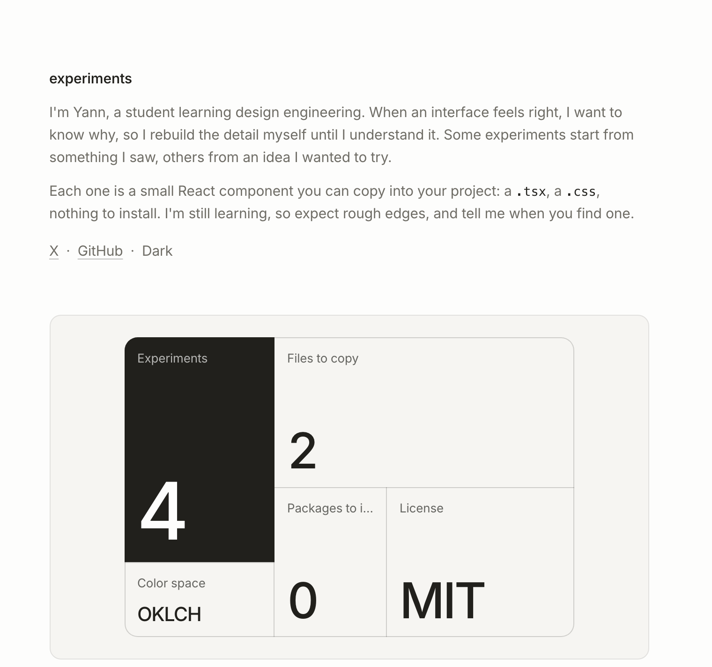
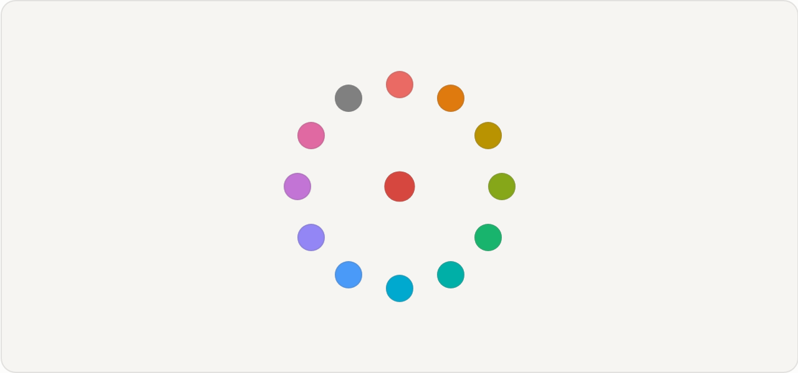
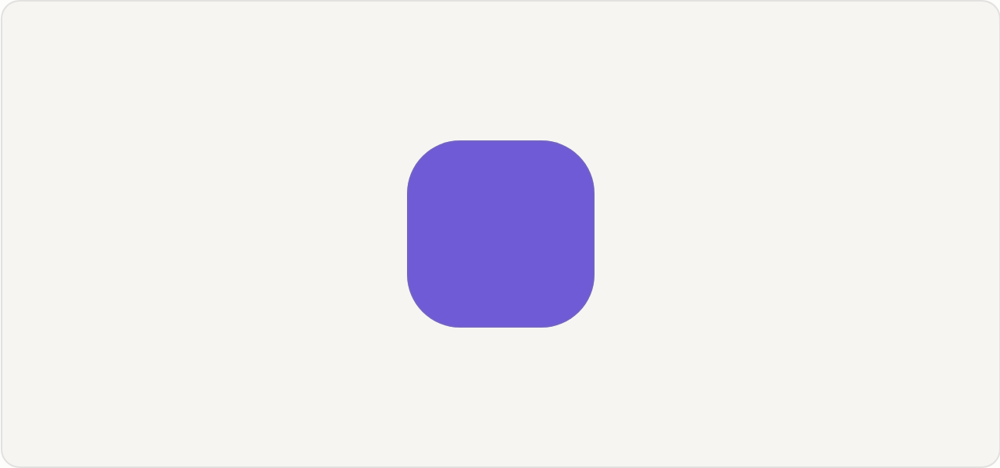
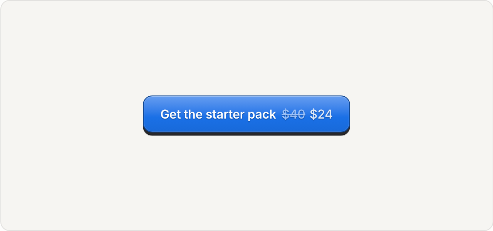

# experiments

<a href="https://ultrararebinary.github.io/experiments/">
  <picture>
    <source media="(prefers-color-scheme: dark)" srcset="docs/readme/hero-dark.png">
    
  </picture>
</a>

Small interface experiments, free to copy. Each one is a React component with its own CSS file and nothing to install: copy the two files into your project and change whatever you like.

I'm Yann, a student learning design engineering. I rebuild interface details here to understand why they feel right. You can find me on [X](https://x.com/yannworks).

## Try them

The previews below are pictures. The components themselves are live on the [site](https://ultrararebinary.github.io/experiments/), where you can press, drag and read their code.

<!-- experiments:start -->

### [Color Bloom](https://ultrararebinary.github.io/experiments/#/color-bloom)

<a href="https://ultrararebinary.github.io/experiments/#/color-bloom">
  <picture>
    <source media="(prefers-color-scheme: dark)" srcset="docs/readme/color-bloom-dark.png">
    
  </picture>
</a>

A color picker that is only a dot until you press it. Petals unfurl, you slide to one, and its color runs back into the dot.

### [Color Drift](https://ultrararebinary.github.io/experiments/#/color-drift)

<a href="https://ultrararebinary.github.io/experiments/#/color-drift">
  <picture>
    <source media="(prefers-color-scheme: dark)" srcset="docs/readme/color-drift-dark.png">
    
  </picture>
</a>

A color picker with nothing on it. Drag the color itself, and the new shade spreads out from your finger like ink.

### [Glossy button](https://ultrararebinary.github.io/experiments/#/glossy-button)

<a href="https://ultrararebinary.github.io/experiments/#/glossy-button">
  <picture>
    <source media="(prefers-color-scheme: dark)" srcset="docs/readme/glossy-button-dark.png">
    
  </picture>
</a>

A raised button lit from above, in three variants. One accent color drives the gradient and rim.

<!-- experiments:end -->

## Use one

Copy the component and its stylesheet into the same folder of your project, then import it:

```tsx
import { ColorBloom } from './ColorBloom'

<ColorBloom defaultValue="#d6473f" onChange={setColor} />
```

Both files are also on the experiment's page, each with a copy button. They need React 19 and nothing else: no Tailwind, no animation library, no build setup beyond importing a CSS file.

Every experiment lives in `experiments/<name>/` and has four files: the component (`<Name>.tsx`), its stylesheet (`<Name>.css`), `demo.tsx` for the page on the site, and a `README.md` with usage notes and credits.

## Run it locally

You need Node.js 22 or newer.

```sh
npm install
npm run dev
```

Then open http://localhost:4318/experiments/.

`npm run build` type-checks the project and builds the site into `dist/`. `npm run preview` serves that build under `/experiments/`, the same path GitHub Pages uses.

After adding or changing an experiment, run `npm run readme`. It builds the site, takes a picture of each component in the light and dark themes with Chrome, and rewrites the list above. It needs Chrome installed, or `CHROME_PATH` pointing at it.

## How the site works

The gallery is a small Vite app in `src/`. It finds experiments with `import.meta.glob`, so adding a folder with a `demo.tsx` adds it to the site. Pages use hash URLs (`#/color-bloom`), which lets GitHub Pages serve every page from a single `index.html`. Moving between pages uses the browser's View Transitions API: the preview you opened grows into its demo. The text is set in Inter, which only the gallery loads, so the components don't depend on it. Each push to `main` builds and deploys the site through GitHub Actions.

## License

MIT. Credits for outside inspiration are in each experiment's README.
